<p align="center">
  
</p>

<h3 align="center">Uma marca de tecnologia inventada do zero, da fruta ao site.</h3>

<p align="center">
  <a href="#-a-mango"><b>A Mango</b></a> ·
  <a href="#-a-família"><b>A família</b></a> ·
  <a href="#️-roteiro"><b>Roteiro</b></a> ·
  <a href="#-kit-da-marca"><b>Kit da marca</b></a> ·
  <a href="#️-mango-store"><b>Loja</b></a> ·
  <a href="#-mangobook-pure"><b>MangoBook Pure</b></a> ·
  <a href="#-como-a-gente-trabalha"><b>Processo</b></a> ·
  <a href="#-rodar-localmente"><b>Rodar</b></a>
</p>

<p align="center">
  
  
  
  
  
</p>

<br>

> [!NOTE]
> **A Mango é uma marca fictícia.** Este repositório é uma peça de portfólio: uma paródia de empresa de tecnologia, sem nenhuma relação com a Apple. Produtos, preços e números são inventados.

<br>

## 🥭 A Mango

<table>
<tr>
<td width="60%" valign="top">

### E se a tecnologia tivesse gosto?

Em vez de uma maçã mordida, uma **manga cortada ao meio, com o caroço à mostra**: a ideia de mostrar o que tem por dentro. O logo, o **"D · Caroço"**, é exatamente isso.

A Mango faz objetos que dão vontade de pegar na mão. Alumínio na cor, das bordas às teclas. Nada de cinza por obrigação.

**Pense doce.** é a assinatura. **Nossa cor são todas.** é o manifesto.

</td>
<td width="40%" align="center" valign="middle">
<picture>
  <source media="(prefers-color-scheme: dark)" srcset="public/mango-branco.svg">
  
</picture>
<br><sub><b>D · Caroço</b><br>a manga com o caroço vazado</sub>
</td>
</tr>
</table>

<p align="center">
  
</p>

| Princípio | O que significa |
|:--|:--|
| 🍋 **Doce, nunca enjoativo** | Cor e personalidade, com a contenção de uma página de lançamento de verdade. |
| 🔍 **Mostrar o caroço** | O produto é o protagonista; a interface sai da frente. |
| ✋ **Dá vontade de tocar** | Cada interação responde: vidro, molas, transições que assentam devagar. |
| 🌱 **Doce com o planeta** | Alumínio reciclado e embalagem de fibra (pelo menos na ficção). |

### Duas camadas: a limpa e o Mangy

<table>
<tr>
<td width="34%" align="center">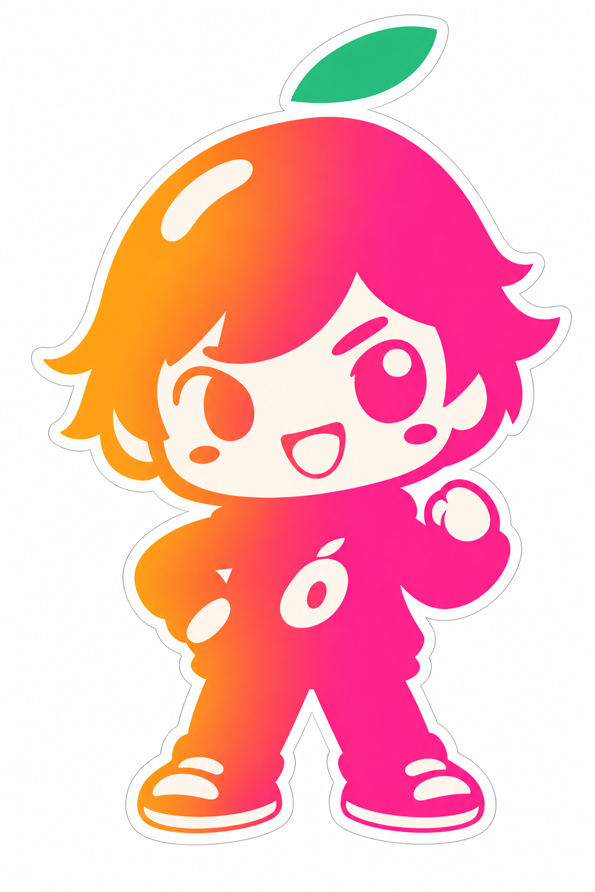</td>
<td width="66%" valign="middle">

A camada **limpa** vende o produto: páginas de lançamento, loja, comparador.

A camada **expressiva** nasce de um personagem, o **Mangy**: uma criança chibi com cabeça de manga, a folha solta do logo e o degradê laranja → rosa-choque. Ele aparece em campanhas, cartões-presente, ícones, selos e, mais pra frente, adesivos.

Tudo o que define a marca está no **[manual da marca](MARCA.md)**.

</td>
</tr>
</table>

<br>

## 🧺 A família

| | Produto | O que é | Situação |
|:-:|:--|:--|:--|
| 💻 | **MangoBook Pure** | O notebook leve e colorido. | ✅ página no ar |
| 💻 | **MangoBook Prime** | O irmão maior, pra quem cria. | 🔜 próxima página |
| 📱 | **Go D1** | O celular. Copia num, cola no outro. | 🔜 |
| 📲 | **Mangopad** | Tablet, caneta e segunda tela pro MangoBook. | 🔜 |
| ⌚ | **Mango Time** | O dia inteiro no pulso. | 🔜 |
| 🎧 | **Mango Seeds** | Fones. Som bem alto. | 🔜 |
| ✨ | **Mango Peels** | Adesivos pra deixar o seu com a sua cara. | 🔜 |

Por baixo de tudo: o chip **Palmer** (nome de uma manga brasileira), a **Mango Intelligence** (IA no próprio aparelho) e o **MangoOS**.

Nomes, preços e status moram num lugar só, [`src/catalogo/produtos.js`](src/catalogo/produtos.js). Menu, rodapé, comparador e páginas leem dali.

<br>

## 🗺️ Roteiro

A ordem é a regra: **primeiro cada produto ganha a sua página, depois vem a loja.** A loja é uma vitrine que manda pra essas páginas, e o kit e a sacola precisam dos preços e opções que cada página define.

- [x] **Marca:** identidade, logo, [`MARCA.md`](MARCA.md), kit da marca e o Mangy
- [x] **Base do site:** rotas, catálogo único, moldura comum, páginas "em breve" e 404
- [x] **MangoBook Pure:** a primeira página de produto, do protótipo ao React
- [ ] **Páginas de produto, uma por uma**, no molde do MangoBook. Cada uma define preço e opções no catálogo
  - [ ] MangoBook Prime · [ ] Go D1 · [ ] Mangopad · [ ] Mango Time · [ ] Mango Seeds · [ ] Mango Peels
- [ ] **Mango Store em `/loja`** (visual aprovado: Galeria 2.0)
  - [ ] Leva 1: campanha, categorias, lançamentos, kit "Juntos é mais doce", acessórios e sacola
  - [ ] Leva 2: cartazes, personalize, "Por que Mango", oficinas e lojas especiais
- [ ] **Adesivos por IA**, um por um, no padrão do Batmango
- [ ] **Publicar online.** A raiz vira a tela inicial da Mango e o MangoBook ganha a própria rota

<br>

## 🎨 Kit da marca

O design system saiu do `MARCA.md` e virou prancha, feita em código e lendo as mesmas variáveis do site ([`src/marca/marca.css`](src/marca/marca.css)). Trocar uma cor no CSS muda o site e as pranchas juntos.

<p align="center">
  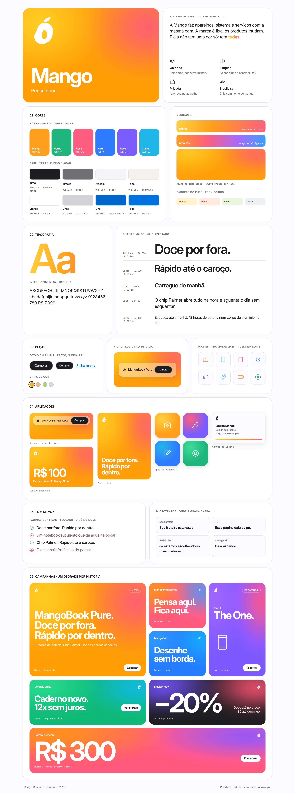
  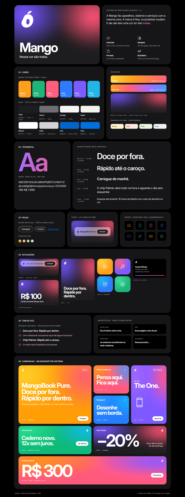
</p>

| Prancha | O que mostra |
|:--|:--|
| [`prancha.html`](escolhas/marca/prancha.html) | Cores, degradês, tipografia, peças, aplicações, tom de voz e campanhas. |
| [`logo.html`](escolhas/marca/logo.html) | Versões do logo, fundos, respiro, tamanhos e o que não fazer. |
| [`mascote.html`](escolhas/marca/mascote.html) | O Mangy: expressões, 6 cores, só os olhos, ícone, selo, maturação, cartaz e textura. |
| [`apps.html`](escolhas/marca/apps.html) | Os ícones dos apps do MangoOS. |
| [`cartoes.html`](escolhas/marca/cartoes.html) | 12 cartões-presente: valor gigante, um degradê e o Mangy. |
| [`adesivos.html`](escolhas/marca/adesivos.html) | Rascunho em SVG. Os definitivos vão ser feitos por IA. |

Cada prancha troca entre **6 temas de degradê** (Manga, Arco-íris, Uva, Oceano, Folha, Noite) pelo seletor ou pela URL (`?v=uva`). Com `npm run dev` rodando, `node scripts/kit.mjs` gera os PNGs de todas em `docs/imagens/kit/`.

<br>

## 🛍️ Mango Store

<p align="center">
  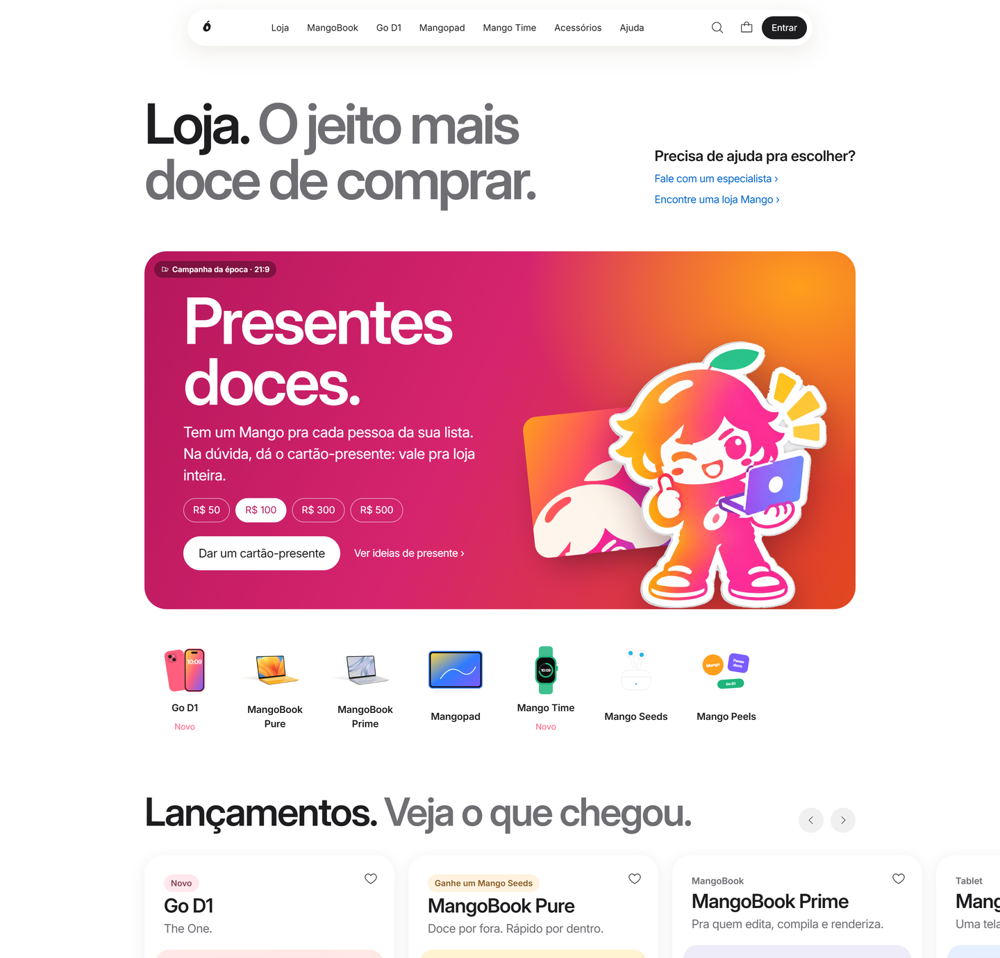
</p>

O protótipo testou **5 vitrines** lado a lado. A escolhida foi a **Galeria**, depois revisada como **Galeria 2.0**:

- **Campanha da época** em degradê, com o Mangy e o cartão-presente;
- **"Juntos é mais doce"**, o ponto alto da página: você monta um kit e vê o que os aparelhos fazem juntos e quanto economiza;
- espaços de anúncio nos formatos finais (21:9, 4:5, 3:1), seção **"Por que Mango"**, gravação na tampa, oficinas e lojas especiais.

Protótipo em [`escolhas/loja.html`](escolhas/loja.html). Vai pro React depois das páginas de produto.

<br>

## 💻 MangoBook Pure

<p align="center"><b>Doce por fora. Rápido por dentro.</b></p>

<p align="center">
  
</p>

<table>
<tr>
<td align="center" width="25%"><h2>13,6"</h2><sub>tela Pure Retina</sub></td>
<td align="center" width="25%"><h2>18 h</h2><sub>de bateria</sub></td>
<td align="center" width="25%"><h2>1,2 kg</h2><sub>alumínio reciclado</sub></td>
<td align="center" width="25%"><h2>0 dB</h2><sub>sem ventoinha</sub></td>
</tr>
</table>

A primeira página de produto da Mango e o molde das próximas: **15 seções** contadas pelo scroll, no estilo das páginas de lançamento. O nome vem de **purê** de manga, sem o "ê".

<p align="center">
  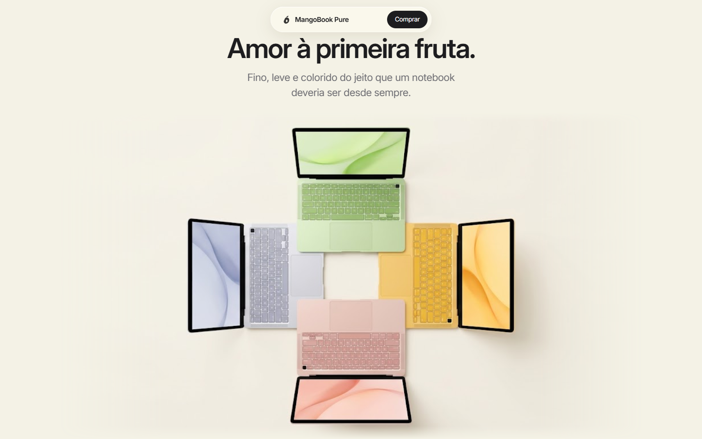
  <br><b>Amor à primeira fruta.</b> <sub>Os quatro sabores abertos, arrumados como as fatias de uma manga.</sub>
</p>

<table>
<tr>
<td width="50%">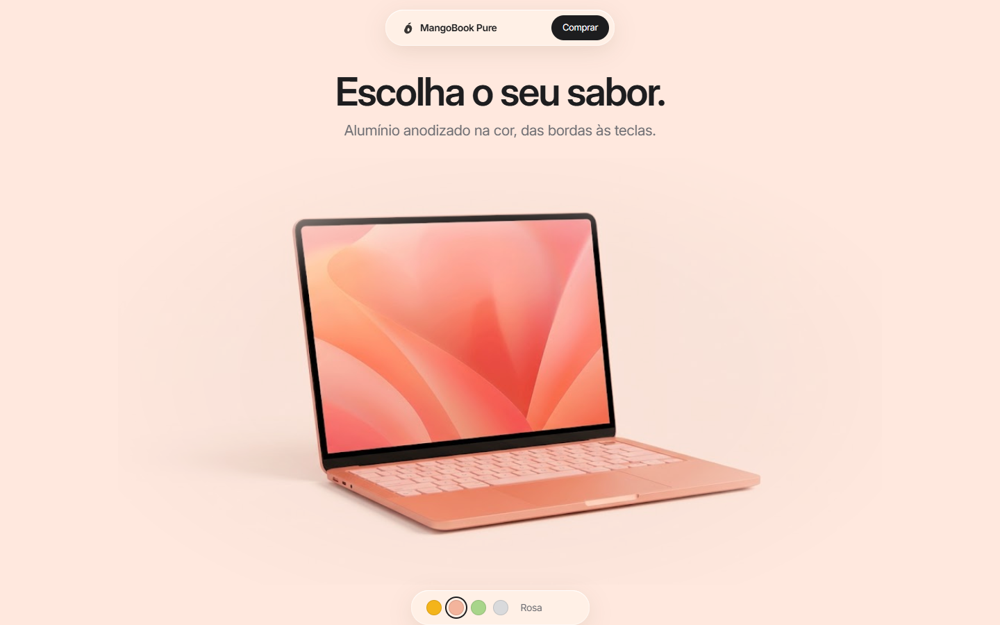<br><b>Escolha o seu sabor.</b><br><sub>A seção inteira tinge na cor escolhida.</sub></td>
<td width="50%">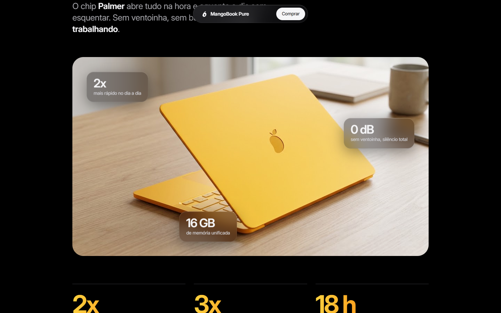<br><b>Feito pra fazer e acontecer.</b><br><sub>Cartões de vidro e abas de uso.</sub></td>
</tr>
<tr>
<td width="50%">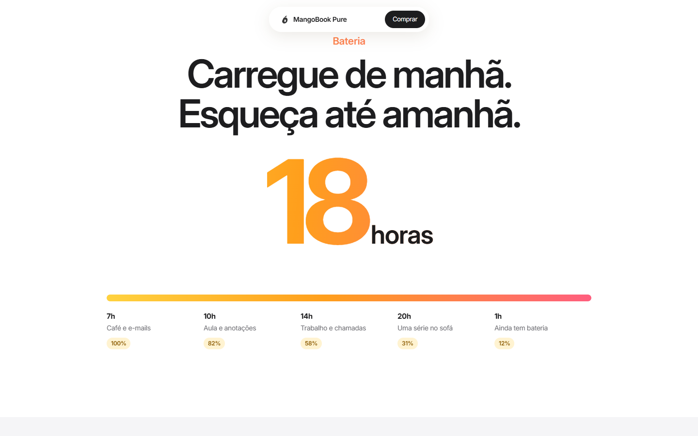<br><b>Carregue de manhã. Esqueça até amanhã.</b><br><sub>O número conta até 18 e a linha do dia enche.</sub></td>
<td width="50%"><br><b>Pede que ele faz.</b><br><sub>Uma mensagem reescrita letra por letra, em três tons.</sub></td>
</tr>
</table>

<details>
<summary><b>Mais telas e as 15 seções</b></summary>
<br>

<table>
<tr>
<td width="50%">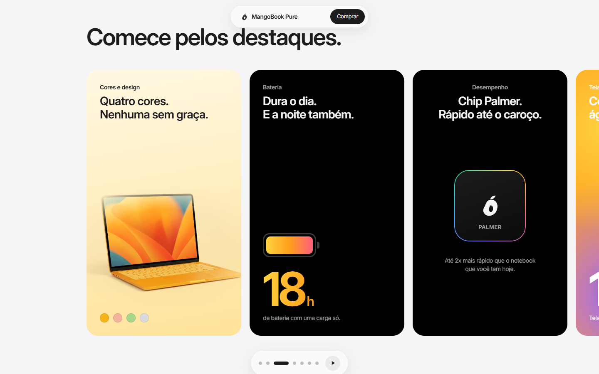<br><sub><b>Destaques:</b> 7 cards com avanço automático.</sub></td>
<td width="50%">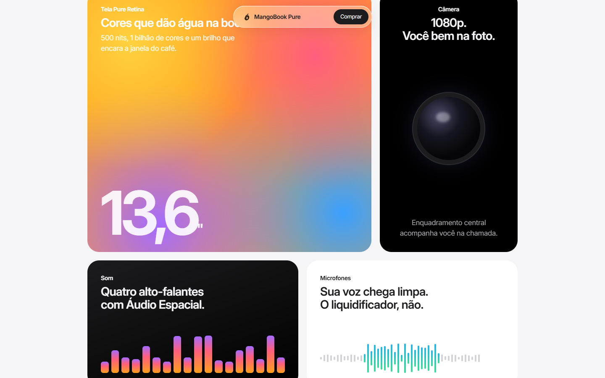<br><sub><b>Sentidos:</b> bento com equalizador e microfones.</sub></td>
</tr>
<tr>
<td width="50%"><br><sub><b>Comparador:</b> o modelo escolhido vem pra frente.</sub></td>
<td width="50%">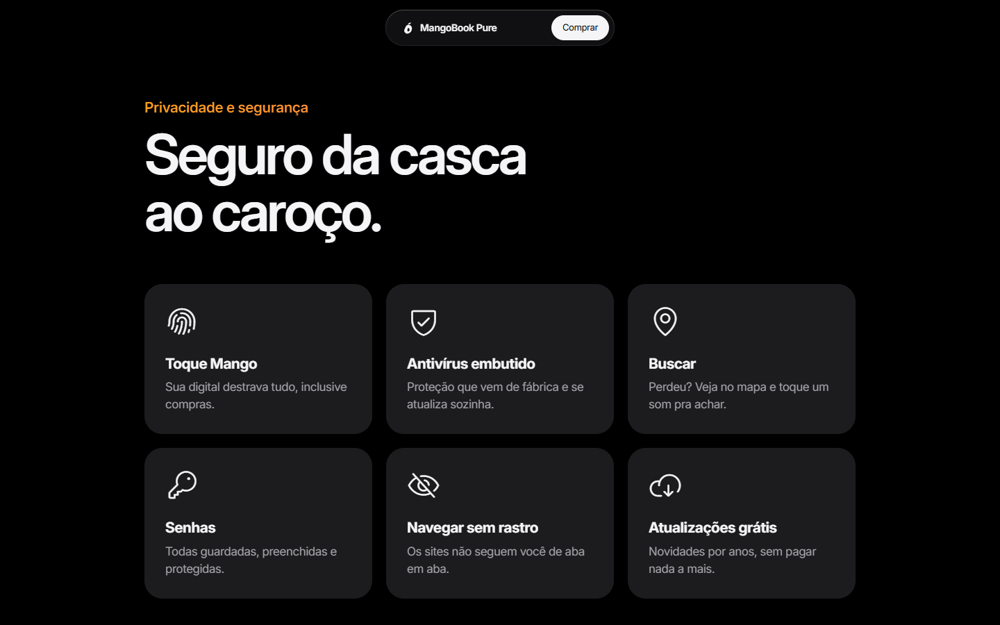<br><sub><b>Segurança:</b> ícones que acendem em cada cor.</sub></td>
</tr>
<tr>
<td width="50%" align="center"><br><sub>No celular: o banho de cor no sabor Folha.</sub></td>
<td width="50%" align="center">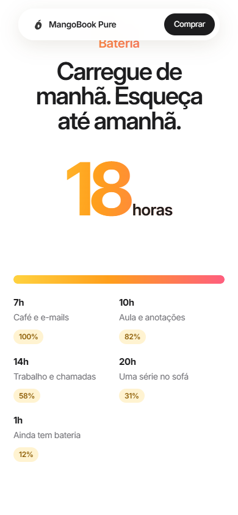<br><sub>A linha do dia em duas colunas.</sub></td>
</tr>
</table>

| # | Seção | O que acontece |
|:-:|:--|:--|
| 1 | **Abertura** | Foto em tela cheia e barra de compra em vidro com as quatro cores. |
| 2 | **Destaques** | Carrossel de cards claros, escuros e em degradê. |
| 3 | **Amor à primeira fruta** | Os quatro sabores abertos, como fatias de manga. |
| 4 | **Escolha o seu sabor** | Seletor de cor com banho de cor. |
| 5 | **Desempenho** | Chip Palmer, cartões de vidro e abas de uso. |
| 6 | **Bateria** | Contador até 18 h e a linha de um dia inteiro. |
| 7 | **Tela, câmera e som** | Bento com equalizador e microfones. |
| 8 | **Mango Intelligence** | Demo de reescrita ao vivo. |
| 9 | **MangoOS** | Sanfona que reorganiza a tela ao lado. |
| 10 | **Mango + Go D1** | Seis recursos de continuidade. |
| 11 | **Privacidade e segurança** | Seis cards em fundo preto. |
| 12 | **Motivos pra comprar** | Cards que abrem com um "+". |
| 13 | **Qual MangoBook é o seu?** | Comparador Pure × Prime. |
| 14 | **Meio ambiente** | Três números de impacto. |
| 15 | **Chamada final e rodapé** | Com o aviso de paródia, sempre. |

</details>

<br>

## 🧪 Como a gente trabalha

O visual é decidido **antes** do código. Cada escolha vira uma página em [`escolhas/`](escolhas/) com várias opções lado a lado, testadas no navegador. Só o que foi aprovado vai pro React.

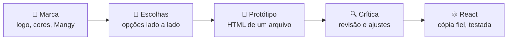

| Decisão | Opções testadas | Escolha |
|:--|:--|:--|
| **Abertura do MangoBook** | Neo clássico · Imersivo · Editorial | [Imersivo](escolhas/abertura-notebook.html) |
| **Navbar** | 6 variações de vidro | [Ilha que encolhe](escolhas/navbars.html) ao rolar |
| **Troca de cor** | 7 transições | [Banho de cor](escolhas/transicao-cores.html) |
| **Ícones** | 5 estilos | [Traço fino, uma cor só](escolhas/icones.html) |
| **Imagem do "Amor à primeira fruta"** | Fatias · Fruteira · Pilha de sabores | [Fatias](escolhas/amor-imagem.html) |
| **Loja** | Galeria · Bento · Editorial · Catálogo · Palco | [Galeria 2.0](escolhas/loja.html) |

**Do protótipo ao React, sem mudar um pixel.** Um script abre o protótipo e o React lado a lado no Chrome, em 1440 × 900 e 390 × 844, tira um print de cada seção e de cada interação e compara pixel a pixel. Resultado no MangoBook Pure: **0,00% de diferença**.

<details>
<summary><b>Detalhes de interação</b></summary>
<br>

- **Ilha que encolhe:** a navbar de vidro mostra tudo no topo e encolhe pra "nome + Comprar" ao rolar. Reabre no hover e no foco do teclado, e fica escura sobre seções pretas.
- **Banho de cor:** escolher uma cor tinge a seção inteira no tom da fruta.
- **Fundo que se funde:** cada seção com foto pega a cor do fundo da própria imagem, sem emenda.
- **Motion com propósito:** curvas que assentam devagar (`cubic-bezier(0.32, 0.72, 0, 1)`), sem bounce. Tudo respeita `prefers-reduced-motion` e `prefers-reduced-transparency`.
- **Acessibilidade:** abas e seletores com papel ARIA, navegação por setas e foco visível.

</details>

<details>
<summary><b>Antes de tudo: um teclado em 3D</b></summary>
<br>

O projeto começou como o **Mango FORGE 75**, um teclado mecânico com modelo 3D procedural em Three.js que se desmontava em 8 camadas conforme o scroll. O visual não convenceu e o foco virou o MangoBook. O código está nas branches `site-parte-1` e `backup/site-parte-1`, e o que sobrou na main fica em [`arquivo/teclado/`](arquivo/teclado/).

</details>

<br>

## 🛠️ Stack

<table>
<tr>
<td align="center" width="20%"><br><sub><b>React 19</b></sub></td>
<td align="center" width="20%"><br><sub><b>React Router 7</b></sub></td>
<td align="center" width="20%"><br><sub><b>Vite 8</b></sub></td>
<td align="center" width="20%"><br><sub><b>CSS moderno</b></sub></td>
<td align="center" width="20%"><br><sub><b>node --test</b></sub></td>
</tr>
</table>

Sem biblioteca de animação nem de componentes: o movimento é CSS e `requestAnimationFrame`. Ícones [Phosphor](https://phosphoricons.com), fonte [Inter](https://rsms.me/inter/). Imagens de produto e o Mangy foram gerados por IA.

<br>

## 🚀 Rodar localmente

```bash
git clone https://github.com/guilhermesolagarcia/Projeto-Hardware.git
cd Projeto-Hardware
npm install
npm run dev
```

| Endereço | O que abre |
|:--|:--|
| `localhost:5173/` | 💻 MangoBook Pure (por enquanto; depois vira a tela inicial da Mango) |
| `localhost:5173/mangobook-pure` | A mesma página, no endereço próprio |
| `/go-d1`, `/mangopad`, `/loja`… | "Em breve" pro que ainda não tem página, lido do catálogo |
| qualquer outro endereço | 404: "Essa página caiu do pé." |
| `localhost:5173/escolhas/` | O índice das escolhas de design e do kit da marca |
| `localhost:5173/escolhas/loja.html` | O protótipo da Mango Store |

```bash
npm test        # catálogo, abas, specs, textos e a independência de src/marca
npm run build   # build de produção
```

<details>
<summary><b>Estrutura de pastas</b></summary>
<br>

```
Projeto-Hardware/
├── MARCA.md           manual da marca (vale pra tudo da Mango)
├── src/               o site em React
│   ├── catalogo/      produtos.js: fonte única de nomes, preços e status
│   ├── paginas/       uma por rota + a Moldura (navbar e rodapé)
│   ├── marca/         peças da marca, reaproveitadas em todas as páginas
│   ├── secoes/        as seções do MangoBook Pure
│   ├── ganchos/       lógica repetida (aparição, abas, cor da foto)
│   └── dados/         textos, specs e funções puras (com testes)
├── public/            logo e imagens dos produtos
├── escolhas/          páginas de decisão de design e protótipos (loja)
│   └── marca/         o kit da marca: prancha, logo, mascote, apps, cartões
├── IA/                o que a gente gerou por IA (Mangy, adesivos)
├── refs/              inspiração de fora e prompts
├── scripts/           kit.mjs (PNGs das pranchas), recortar-mascote.py
├── docs/              RETOMAR.md, specs, planos e imagens deste README
└── arquivo/teclado/   o FORGE 75 arquivado
```

</details>

<br>

## 👋 Autor

<table>
<tr>
<td width="120" align="center">

</td>
<td>

### Guilherme Sola Garcia

Este projeto é parte do meu **portfólio**: marca, design de produto, motion e front-end.

[](https://github.com/guilhermesolagarcia)

</td>
</tr>
</table>

<br>

---

<p align="center">
  <sub>Mango, MangoBook, Go D1, Mangopad, Mango Time, Mango Seeds, Mango Peels, chip Palmer e MangoOS são uma paródia fictícia, criada como projeto de portfólio, sem nenhuma relação com a Apple Inc.<br>Produtos, preços e números são ilustrativos.</sub>
</p>

<p align="center">
  <picture>
    <source media="(prefers-color-scheme: dark)" srcset="public/mango-branco.svg">
    
  </picture>
  <br>
  <sub>Pense doce. Feito com 🥭 por <b>Guilherme Sola Garcia</b></sub>
</p>
